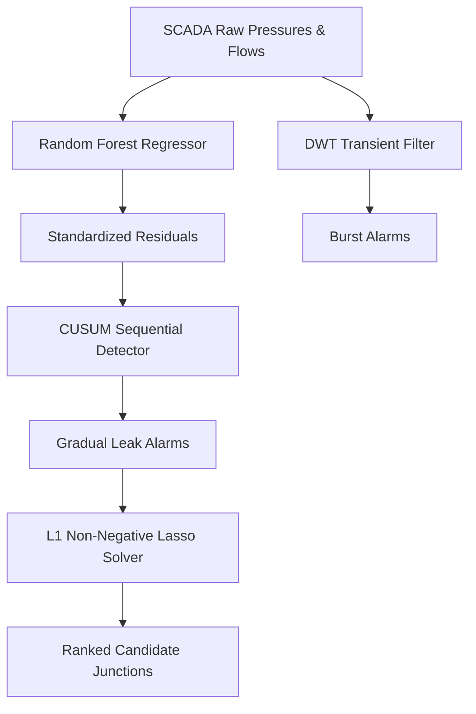

# Fluid Leakage Detection & Sparse Localization Portfolio (v2.0.1 — corrective audit release)

[](https://doi.org/10.5281/zenodo.20786240)

**Release v2.0.1 (2026-11-11): CORRECTION / AUDIT, NOT A VALIDATED DETECTOR.** The original v2.0.0 Zenodo snapshot ([DOI 10.5281/zenodo.20786241](https://doi.org/10.5281/zenodo.20786241)) is a historical, reproducible artifact whose original performance claims have been challenged. The concept DOI above covers the linked version series; cite a **version-specific DOI** when available. See [CHANGELOG.md](CHANGELOG.md) and [AUDIT_2026-11.md](AUDIT_2026-11.md).

A leak detection and sparse localization pipeline for Water Distribution Networks (WDNs), run on the **BattLeDIM L-Town benchmark** (a simulated SCADA dataset modelled on a real network in Cyprus: 33 pressure sensors, diurnal demand, gradual and abrupt leaks), with a small **C++ reference implementation** of the detector for embedded targets.

> **Audit notice (November 2026).** A self-audit of the v2.0.0 evaluation found that its headline numbers reproduce exactly but do **not** demonstrate working leak detection or localization: the training window is not leak-free, the evaluator mixes units, the alarm state never clears, and the localization summary omitted three to four of the seven results. Details and verdicts: [`AUDIT_2026-11.md`](AUDIT_2026-11.md). The v2.0.0 numbers below are kept for reproducibility and annotated; treat this repository as a methods prototype, not a validated detector.

---

## What v2 contains
- **Benchmark run**: The pipeline runs on the 2018 L-Town dataset (BattLeDIM, Zenodo 10.5281/zenodo.4017659): 33 pressure sensors, 3 flow sensors, 14 labelled leaks. Training and scoring both happen inside 2018; this is not the BattLeDIM task (2018 as history, 2019 as test) and the results are not comparable to the BattLeDIM leaderboard.
- **CUSUM detector**: A one-sided CUSUM on Random Forest regression residuals, with the threshold set above the training-window maximum. Under the repository's own evaluator the score moves from F1 0.095 (consecutive exceedance) to 0.278 (CUSUM). The audit rates this **Not Demonstrated** as a performance measure: the training window is 94.5% leak-active, the evaluator scores only each sensor's first alarm and counts true positives in events but false positives in sensors, and after the training window at least one sensor is in alarm 99.9% of the time.
- **L1-regularized sparse localization (Lasso)**: Localization over 782 junctions from 33 sensors, formulated as non-negative sparse recovery on a linearized sensitivity matrix. On the 7 leaks evaluated, no leak is in the top-5 candidates under either method; the median top-1 error is 43 hops (Lasso) and 55 hops (WLS). One leak (`p183`) goes from 57 to 2 hops; the Lasso returns the same node for three different leaks, so this single case is not evidence of an improvement.
- **C++ reference engine**: `DwtCusumEngine` (C++11) implements the CUSUM and a Haar level-1 detail check with fixed-size state and no dynamic allocation in the engine class. It has been compiled and replayed on a desktop only; it has not been run on a microcontroller or on field data.

---

## 🛠️ Pipeline Architecture & Methodology



### 1. DWT Burst Transient Detection (`src/dwt_detector.py`)
Discrete Wavelet Transform detail coefficients isolate high-frequency acoustic wave reflections and sharp pressure steps characteristic of sudden pipe ruptures. The Python pipeline uses a `db4` wavelet at level 3, while the C++ edge code uses a lightweight `Haar` wavelet at level 1 to run efficiently on resource-constrained microcontrollers. The threshold is adaptively set using a robust MAD (Median Absolute Deviation) estimator:
$$\text{Threshold} = 3.5 \times \frac{\text{MAD}}{0.6745}$$

### 2. Machine Learning Baseline & CUSUM Sequential Detection (`src/leak_predictor.py`)
A Random Forest Regressor models the complex diurnal demand-pressure relationships, trained on the first 40% of the dataset. This window was assumed leak-free; on L-Town 2018 it is not (see audit notice). CUSUM accumulates persistent small negative deviations from this baseline:
$$S_t = \max(0, S_{t-1} - z_t - k)$$
where $z_t$ is the standardized residual, $k$ is the drift parameter (optimized at $0.5$), and the threshold $H$ is auto-tuned on training residuals with a $5\sigma$ safety margin.

### 3. L1 Sparse Localization (`src/leak_localizer.py`)
Rather than running independent fits per node, localization solves a sparse recovery problem across all 782 network junctions using the linearized hydraulic sensitivity matrix $S$:
$$\min_{\mathbf{q} \ge 0} \frac{1}{2} \|\mathbf{r} - \mathbf{S}\mathbf{q}\|_2^2 + \alpha \|\mathbf{q}\|_1$$
where $\mathbf{r}$ is the sensor pressure residual vector, $\mathbf{S}_{33 \times 782}$ is the sensitivity matrix, and $\mathbf{q} \ge 0$ is the sparse vector of estimated junction leak flows.

*Note: on L-Town 2018 neither method localizes the evaluated leaks (median top-1 error 43 hops for Lasso, 55 for WLS; full table in `AUDIT_2026-11.md`).*

---

## 📊 v2.0.0 numbers (L-Town 2018, repository evaluator) — see audit notice

| Config ID | Detector | Localizer | Precision | Recall | F1-Score | Mean TTD | Localization Accuracy |
| :--- | :--- | :--- | :---: | :---: | :---: | :---: | :--- |
| **v1_baseline** | Consecutive | WLS | 0.071 | 0.143 | 0.095 | 3.1 h | Not independently re-evaluated (the 55-hop WLS median below uses CUSUM-triggered windows) |
| **v2_cusum_wls** | CUSUM ($k=0.5$) | WLS | 0.227 | 0.357 | 0.278 | 20.6 h | median 55 hops (7 leaks) |
| **v2_cusum_lasso**| CUSUM ($k=0.5$) | Lasso ($\alpha=10^{-4}$) | 0.227 | 0.357 | 0.278 | 20.6 h | median 43 hops (7 leaks) |

*How to read this table: The 55-hop WLS and 43-hop Lasso medians were reconstructed only with the CUSUM-triggered localization windows, not the consecutive baseline. Precision = detected events / (detected events + sensors whose first alarm matched no event); Recall = detected events / 14, of which 7 start inside the training window and cannot be detected. Only the first alarm of each sensor is scored. These are the numbers the code prints, not a validated detection rate. `verified_results.json` carries the same v2.0.0 figures and omits the hop distances for `p31`, `p654` (WLS), `p810` and `p866`.*

---

## 💻 Edge C++ Implementation (`edge/`)
The engine class keeps fixed-size state (no dynamic allocation) and does $O(1)$ work per sample. The replay harness (`main.cpp`) is a desktop program. The replay input `edge/sensor_test_data.csv` is derived from the BattLeDIM data and is not included in the repository, so the output below cannot be reproduced from a fresh clone.

### Build and Run Edge Simulation Replay:
```bash
make -C edge
./edge/edge_detector
```

Outputs:
```text
========================================================
  C++ Standalone Edge DWT + CUSUM Leak Detection Engine 
========================================================
Replaying pressure trace from: edge/sensor_test_data.csv

[ALARM: BURST] DWT detail magnitude (0.707107) exceeded threshold at t = 3686.75 h
[ALARM: LEAK] CUSUM accumulated sum reached threshold (8.26604) at t = 3907.75 h (Pressure drop residual: -0.05966 m)
...
--------------------------------------------------------
  REPLAY COMPLETED (35038 steps)
--------------------------------------------------------
  CUSUM Leak Alarms Fired:  17
  First Leak Alarm Time:    782.5 h
  DWT Burst Alarms Fired:   134
  First Burst Alarm Time:   16.25 h
========================================================
```

---

## 🚀 Quick Start (Python Pipeline)

### Installation
```bash
pip install -r requirements.txt
```

For `--mode real`, download the BattLeDIM CSVs and `L-TOWN.inp` (Zenodo 10.5281/zenodo.4017659) into `./battledim_data/`.

### Re-run the audit
```bash
python scripts/audit_evaluation.py .
```

### Run CUSUM + Lasso Pipeline on L-Town SCADA:
```bash
python run_pipeline.py --mode real --resample 15min --detector cusum --cusum-drift 0.5 --localizer lasso --lasso-alpha 0.0001
```

This generates:
- Diagnostic Plot: `results/real_cusum_lasso_leak_detection_isolation.png`
- Performance Summary: `results/real_cusum_lasso_performance_report.txt`

---

## 📖 Domain Connection & NILM Analogy
This project applies Non-Intrusive Grid Monitoring principles to hydraulic networks. In electrical networks, NILM (Non-Intrusive Load Monitoring) disaggregates house-level power readings into individual appliance states. In water networks, we use boundary measurements (pressures, flows) and physical/hydraulic sensitivity matrices (the fluid analog of grid impedance matrices) to localize and estimate leakage signatures at unmonitored interior junctions.

---

## 📌 Citation
If you use this software in your research or portfolio reviews, please cite it as:
```text
Nestorov, Ivan. (2026). Fluid Leakage Detection and L1-Regularized Sparse Localization for WDNs (v2.0.0). Zenodo. https://doi.org/10.5281/zenodo.20786241
```

---

## 📄 License
MIT — see [`LICENSE`](LICENSE). The BattLeDIM dataset is not part of this repository and has its own terms.
