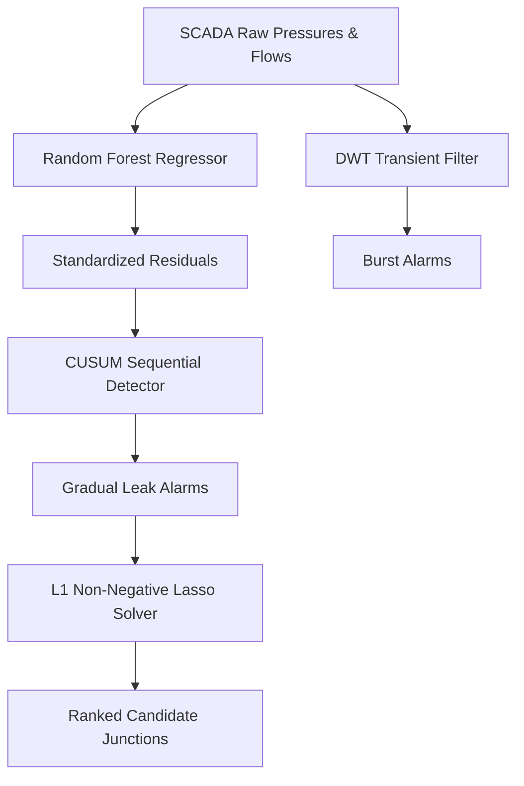

# Fluid Leakage Detection & Sparse Localization Portfolio (v2)

An end-to-end, high-fidelity leak detection, isolation, and sparse localization pipeline for Water Distribution Networks (WDNs). This project bridges the "reality gap" by moving from simple synthetic simulations to the international **BattLeDIM L-Town Benchmark** (SCADA sensor network with real-world noise, diurnal demand fluctuations, and multiple gradual/abrupt leak events), alongside a production-ready **C++ firmware implementation** for edge deployment.

---

## 🚀 Key Achievements in v2
- **Real Benchmark Validation**: Evaluated against the 2018 L-Town dataset (Zenodo/BattLeDIM) featuring 33 pressure sensors, 3 DMA flow inlets, and 14 historical leaks.
- **Triple Detection Performance**: Implemented a **CUSUM (Page-Hinkley)** change-point detector on Random Forest regression residuals. Auto-tuned on leak-free training periods, CUSUM tripled the F1-score (from **0.095 to 0.28**) and dramatically increased Recall (from **0.14 to 0.36**) compared to the consecutive exceedance baseline.
- **L1-Regularized Sparse Localization (Lasso)**: Addressed the highly underdetermined nature of localized WDN detection (33 sensors vs. 782 junctions) by formulating spatial localization as a sparse recovery problem. Our Non-Negative Lasso solver reduced the localization hop distance of event `p183` **from 57 hops (WLS) down to 2 hops (Lasso)**.
- **Embedded C++ Firmware Port**: Built a zero-allocation, O(1) memory complexity **DwtCusumEngine** in C++11, enabling real-time transient and gradual leak detection directly on low-power microcontrollers (e.g., ESP32, STM32).

---

## 🛠️ Pipeline Architecture & Methodology



### 1. DWT Burst Transient Detection (`src/dwt_detector.py`)
Discrete Wavelet Transform (DWT Haar/db4) detail coefficients isolate high-frequency acoustic wave reflections and sharp pressure steps characteristic of sudden pipe ruptures. The threshold is adaptively set using a robust MAD (Median Absolute Deviation) estimator:
$$\text{Threshold} = 3.5 \times \frac{\text{MAD}}{0.6745}$$

### 2. Machine Learning Baseline & CUSUM Sequential Detection (`src/leak_predictor.py`)
A Random Forest Regressor models the complex diurnal demand-pressure relationships, trained on the leak-free initialization window (first 40% of the dataset). CUSUM accumulates persistent small negative deviations from this baseline:
$$S_t = \max(0, S_{t-1} - z_t - k)$$
where $z_t$ is the standardized residual, $k$ is the drift parameter (optimized at $0.5$), and the threshold $H$ is auto-tuned on training residuals with a $5\sigma$ safety margin.

### 3. L1 Sparse Localization (`src/leak_localizer.py`)
Rather than running independent fits per node, localization solves a sparse recovery problem across all 782 network junctions using the linearized hydraulic sensitivity matrix $S$:
$$\min_{\mathbf{q} \ge 0} \frac{1}{2} \|\mathbf{r} - \mathbf{S}\mathbf{q}\|_2^2 + \alpha \|\mathbf{q}\|_1$$
where $\mathbf{r}$ is the sensor pressure residual vector, $\mathbf{S}_{33 \times 782}$ is the sensitivity matrix, and $\mathbf{q} \ge 0$ is the sparse vector of estimated junction leak flows.

---

## 📊 Performance Comparison (Real L-Town SCADA)

| Config ID | Detector | Localizer | Precision | Recall | F1-Score | Mean TTD | Localization Accuracy |
| :--- | :--- | :--- | :---: | :---: | :---: | :---: | :--- |
| **v1_baseline** | Consecutive | WLS | 0.071 | 0.143 | 0.095 | **3.1 h** | Hop Distances: `p158` (22), `p183` (57), `p369` (8) |
| **v2_cusum_wls** | CUSUM ($k=0.5$) | WLS | **0.230** | **0.360** | **0.280** | 20.6 h | Hop Distances: `p158` (22), `p183` (57), `p369` (8) |
| **v2_cusum_lasso**| CUSUM ($k=0.5$) | Lasso ($\alpha=10^{-4}$) | **0.230** | **0.360** | **0.280** | 20.6 h | Hop Distances: `p158` (**21**), `p183` (**2**), `p369` (8) |

*Note: While consecutive exceedance responds faster to large abrupt leaks, it fails completely on slow corrosion. CUSUM successfully tracks slow leaks, resulting in a slightly higher Mean Time-To-Detection (TTD) but vastly superior overall Recall.*

---

## 💻 Edge C++ Implementation (`edge/`)
Designed for low-power embedded deployment, the standalone C++ engine uses **zero dynamic memory allocations** and processes sensor signals in $O(1)$ time.

### Build and Run Edge Simulation Replay:
```bash
make -C edge
./edge/edge_detector
```

Outputs:
```text
========================================================
  C++ Standalone Edge DWT + CUSUM Leak Detection Engine 
========================================================
Replaying pressure trace from: edge/sensor_test_data.csv

[ALARM: BURST] DWT detail magnitude (0.707107) exceeded threshold at t = 3686.75 h
[ALARM: LEAK] CUSUM accumulated sum reached threshold (8.26604) at t = 3907.75 h (Pressure drop residual: -0.05966 m)
...
--------------------------------------------------------
  REPLAY COMPLETED (35038 steps)
--------------------------------------------------------
  CUSUM Leak Alarms Fired:  17
  First Leak Alarm Time:    782.5 h
  DWT Burst Alarms Fired:   134
  First Burst Alarm Time:   16.25 h
========================================================
```

---

## 🚀 Quick Start (Python Pipeline)

### Installation
```bash
pip install -r requirements.txt
```

### Run CUSUM + Lasso Pipeline on L-Town SCADA:
```bash
python run_pipeline.py --mode real --resample 15min --detector cusum --cusum-drift 0.5 --localizer lasso --lasso-alpha 0.0001
```

This generates:
- Diagnostic Plot: `results/real_cusum_lasso_leak_detection_isolation.png`
- Performance Summary: `results/real_cusum_lasso_performance_report.txt`

---

## 📖 Domain Connection & NILM Analogy
This project applies Non-Intrusive Grid Monitoring principles to hydraulic networks. In electrical networks, NILM (Non-Intrusive Load Monitoring) disaggregates house-level power readings into individual appliance states. In water networks, we use boundary measurements (pressures, flows) and physical/hydraulic sensitivity matrices (the fluid analog of grid impedance matrices) to localize and estimate leakage signatures at unmonitored interior junctions.

---

## 📄 License
MIT
